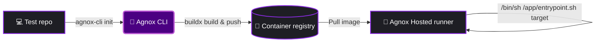

<div align="center">

# 🚀 @agnox/agnox-cli

**Scaffold, build and push Docker test images for Agnox Hosted runs**

[](https://github.com/keinar/agnox-cli/actions/workflows/release.yml)
[](https://www.npmjs.com/package/@agnox/agnox-cli)
[](https://docs.agnox.dev)

</div>

---

`@agnox/agnox-cli` is the companion tool for **Agnox Hosted** runs, where Agnox executes your tests in a managed container started from a Docker image of your test project. The CLI does two things:

- **`init`**: detects your framework and generates a `Dockerfile`, `entrypoint.sh` and `.dockerignore` that follow the Agnox Hosted runner contract, then optionally builds and pushes a multi-arch image.
- **`push`**: rebuilds and pushes that image, interactively or non-interactively from CI.

> **Not using Agnox Hosted?**
> - **External CI** (tests already run in your own pipeline): use [`@agnox/playwright-reporter`](https://www.npmjs.com/package/@agnox/playwright-reporter) to stream results to Agnox. No Docker image needed.
> - **AI assistants / MCP**: use [`@agnox/mcp-server`](https://www.npmjs.com/package/@agnox/mcp-server).

---

## ⚡ Quick Start

```bash
npx @agnox/agnox-cli@latest init
```

Then, in the Agnox Dashboard, open **Settings → Run Settings** and enter the image name the CLI printed (e.g. `your-user/my-tests:latest`).

---

## 🪄 How it works



For every run, the Agnox runner pulls your image and runs `/bin/sh /app/entrypoint.sh "<target>"`. Your image's own `ENTRYPOINT` / `CMD` are not used. `<target>` is one of:

- `all` (or empty): the whole suite;
- a single test folder or spec file, e.g. `tests/e2e`;
- several paths separated by spaces: **Smart PR routing** sends just the specs affected by a pull request, e.g. `specs/login.spec.ts specs/cart`.

The generated `entrypoint.sh` handles all three. If none of the paths exists in the image, the whole suite runs. Otherwise Playwright receives every token (extra tokens such as `smoke` act as Playwright file filters), while Pytest receives only the paths that exist.

---

## 🌟 What the CLI generates

### Playwright (TypeScript / Node.js)
- **Version-pinned base image**: reads the exact `@playwright/test` version from `package-lock.json`, `yarn.lock`, `pnpm-lock.yaml` or `package.json` and uses the matching `mcr.microsoft.com/playwright:v<version>-noble` image (`-jammy` for versions older than 1.45).
- **Runner-aware entrypoint**: uses the reporters (`PLAYWRIGHT_REPORTERS`) and worker count (`PLAYWRIGHT_WORKERS`) Agnox injects, writes `results.json` to `/app/test-results`, and removes any local `.env` so injected configuration wins.

### Pytest (Python)
- **Project analysis**: detects pip or Poetry, the Python version (`pyproject.toml` / `.python-version`), Playwright for Python, Selenium and `allure-pytest`.
- **Base image**: `mcr.microsoft.com/playwright/python:v<version>-noble` when Playwright is used, otherwise `python:<version>-slim`.
- **Browser channels**: `--browser-channel chrome` / `msedge` in your pytest config installs that browser and restricts the build to `linux/amd64` (neither ships for Linux ARM64).
- **Allure**: when enabled and `allure-pytest` is installed in the image, results go to `allure-results`, and Agnox builds the report for you.

### `.dockerignore`
Keeps `.git`, `.env`, dependencies and local report folders (`test-results`, `playwright-report`, `allure-results`, …) out of the image, so old local results can never be mistaken for a new run.

### Multi-arch images
Images are built with Docker Buildx for `linux/amd64` + `linux/arm64`, so they run natively on every Agnox runner.

---

## 🎨 The CLI experience

```text
┌   Agnox CLI
│
◇  Detected PLAYWRIGHT project. Use this framework?
│  Yes
│
◇  What is your Docker Hub username?
│  your-user
│
◇  Detected project name "my-tests". Use this for the image?
│  Yes
│
●  Detected Playwright version: v1.65.1
│
◇  Next steps to connect your project to Agnox
│  1. docker buildx build --platform linux/amd64,linux/arm64 -t your-user/my-tests:latest --push .
│  2. In the Agnox Dashboard, open Settings → Run Settings and enter your-user/my-tests:latest as the Docker image.
│
◇  Do you want to build and push the image to Docker Hub right now?
│  Yes
│
◆  Image your-user/my-tests:latest pushed successfully!
│
└  Done!
```

No Agnox API key is needed: the CLI only talks to Docker and your registry. You connect the image to a project in the dashboard.

---

## ⚙️ Usage

### Prerequisites
- **Node.js 20+**
- **Docker** with Buildx (Docker Desktop includes it), running, for build & push

### Commands

```bash
# Generate files, then optionally build & push (Docker Hub by default)
npx @agnox/agnox-cli@latest init

# Use a private registry (GHCR, AWS ECR, Google Artifact Registry, self-hosted)
npx @agnox/agnox-cli@latest init --registry ghcr.io

# Rebuild & push an existing setup interactively
npx @agnox/agnox-cli@latest push

# Rebuild & push non-interactively (CI/CD)
npx @agnox/agnox-cli@latest push -i <registry/user/project:tag>

npx @agnox/agnox-cli@latest --version
```

| Command | Flag | Description |
|---------|------|-------------|
| `init` | `-r, --registry <url>` | Push to a private registry instead of Docker Hub. |
| `push` | `-i, --image <tag>` | Full image tag; runs without prompts. |

### Workflows

**Easy path:** let `init` build and push. It runs `docker login` (for the registry, if given), creates a Buildx builder and pushes a multi-arch image.

**Custom path:** answer "No" to the build prompt, adjust the generated files, and build yourself:

```bash
docker buildx create --use
docker buildx build --platform linux/amd64,linux/arm64 -t your-user/my-tests:latest --push .
```

Keep these runner requirements when editing:
1. `WORKDIR /app`, with the script at `/app/entrypoint.sh`, executable (`chmod +x`).
2. No `ENTRYPOINT` or `CMD`.
3. `entrypoint.sh` must use Unix (LF) line endings (the CLI enforces this when it writes the file).
4. Accept a space-separated list of paths in `$1` (Smart PR routing).

---

## 🤖 CI/CD (GitHub Actions)

Rebuild the image whenever your tests change:

```yaml
name: Push tests image to Agnox

on:
  push:
    branches: [main]

jobs:
  build-and-push:
    runs-on: ubuntu-latest
    steps:
      - uses: actions/checkout@v4
      - uses: docker/setup-qemu-action@v3
      - uses: docker/setup-buildx-action@v3
      - uses: docker/login-action@v3
        with:
          username: ${{ secrets.DOCKERHUB_USERNAME }}
          password: ${{ secrets.DOCKERHUB_TOKEN }}
      - name: Build and push tests image
        run: npx @agnox/agnox-cli@latest push -i my-docker-org/my-tests:latest
```

> To *trigger* Agnox Hosted runs from CI (including Smart PR routing), see the CI integration guide at [docs.agnox.dev](https://docs.agnox.dev).

---

## 🏢 Private registries

```bash
npx @agnox/agnox-cli@latest init --registry 123456789.dkr.ecr.us-east-1.amazonaws.com
```

1. **Login**: the CLI runs `docker login <registry>`, which prompts for the username and password/token.
2. **Tagging**: the image is tagged `<registry>/<username>/<project>:latest`.
3. **Build**: the same multi-arch Buildx flow runs; only the destination changes.

> **Tip:** for token-based registries such as ECR, paste the output of `aws ecr get-login-password` when prompted for the password, or log in beforehand and skip the CLI's login prompt.

---

## 🛠️ Local development

```bash
npm install
npm run typecheck
npm run build
node dist/index.cjs init
```

---

## 📈 Version history

- **v2.1.0**: Smart PR multi-path targets in generated entrypoints; `PLAYWRIGHT_WORKERS` support; Ubuntu 24.04 (noble) Playwright images; Pytest Allure output; local report folders excluded from the image; Node.js 20+.
- **v2.0.12 / v2.0.13**: `push` command for CI/CD; `--registry` / `-r` flag for private container registries.
- **v2.0.11**: Run specific spec files from `entrypoint.sh` (Smart PR routing).
- **v2.0.7**: Rebrand to Agnox, framework detection, multi-platform Buildx, `@clack/prompts`.
- **v1.1.x**: Initial Playwright / Pytest generation.

---

## 🤝 Support

- Documentation: [docs.agnox.dev](https://docs.agnox.dev)
- Website: [agnox.dev](https://agnox.dev)
- Contact & support: [info@agnox.dev](mailto:info@agnox.dev)
- Book a demo: [sales@agnox.dev](mailto:sales@agnox.dev)

---

## License

MIT
